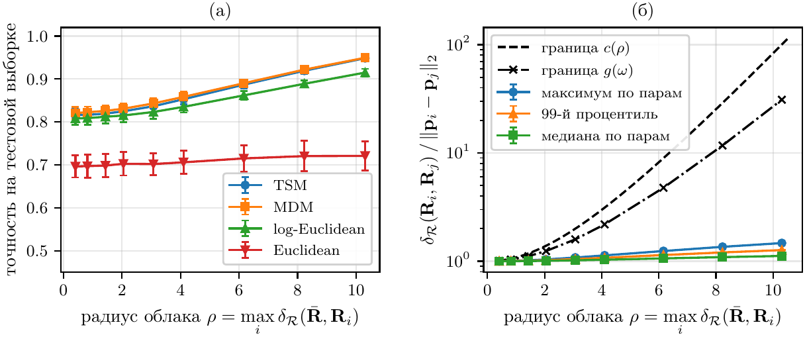

<div align="center">
<h1>Geometric Properties of Tangent-Space Features of Covariance Matrices of Multivariate Time Series</h1>

[Daniil Dorin](https://github.com/DorinDaniil)<sup>1 :email:</sup>

<sup>1</sup> Moscow Institute of Physics and Technology, Moscow, Russia

<sup>:email:</sup> Corresponding author

[📝 Paper](#-citation), [</> Code](https://github.com/DorinDaniil/Tangent-Space-Features/tree/main/code)


</div>

## 💡 Abstract
A multivariate time series is described by the covariance matrix of its channels, and the covariance is projected onto the tangent space of the manifold of symmetric positive definite matrices at the Riemannian mean of the sample; the coordinates of the projection serve as features for a linear classifier. Three properties of this construction are proved. The features are invariant to the units of measurement and to any nonsingular linear mixing of the channels up to an orthogonal rotation that does not change the output of a regularized logistic regression. Euclidean distances between the features never exceed the geodesic distances between the covariances and differ from them by at most an explicit factor that depends only on the largest spectral spread of the tangent vectors, that is, on the logarithm of the condition number of the whitened covariance; the constant is sharp but is not attained on any pair of distinct objects. The error of a covariance estimated from a finite number of samples, measured in the geodesic metric, has a distribution that does not depend on the true covariance and with high probability is bounded by a quantity proportional to the number of channels and inversely proportional to the square root of the number of samples. Experiments on synthetic data and on public EEG recordings show that the proved bounds are conservative: the actual distance distortion is an order of magnitude smaller than guaranteed, and the tangent-space projection matches the geodesic minimum-distance classifier.

## 🔎 Overview
<div align="center">



</div>

The projection onto the tangent space at the Riemannian mean keeps the geometry of the cloud of covariance matrices: radial distances through the reference point are preserved exactly, while tangential displacements that rotate the eigenbasis of a tangent vector are stretched by at most $g(\omega)$. The figure shows the accuracy of four classifiers and the ratio of geodesic to Euclidean distances over all pairs of training objects as the cloud radius grows, together with the bounds $c(\rho)$ and $g(\omega)$ of the paper.

## 🛠️ Repository Structure
The repository is structured as follows:
- `assets`: PNG previews of the figures used in this README.
- `code`: the code of the experiments.
  - `synthetic_experiments.py`: matrix tools, the four classifiers (TSM, MDM, log-Euclidean, Euclidean) and the three synthetic experiments (cloud radius, sharpness of the constant, covariance estimation noise); writes `results.json` and the PDF figures of the paper to a `figs` folder created at the repository root.
  - `replot.py`: redraws the figures from `results.json` without rerunning the experiments.
  - `synthetic_experiments.ipynb`: the same experiments as a notebook.
  - `eeg_check/bci2a_check.py`: the check of the three theorems on the public EEG dataset BCI Competition IV 2a (left vs right hand motor imagery, 22 channels, 250 Hz); `bci2a_check_results.json` contains the results reported in the paper.

```shell
Tangent-Space-Features
├── LICENSE
├── README.md
├── requirements.txt
├── assets
└── code
    ├── synthetic_experiments.py
    ├── replot.py
    ├── synthetic_experiments.ipynb
    ├── results.json
    └── eeg_check
        ├── bci2a_check.py
        └── bci2a_check_results.json
```

## 🚀 Running the Experiments
Install the dependencies and run the synthetic experiments (about four minutes on a laptop):
```shell
pip install -r requirements.txt
python code/synthetic_experiments.py
```
The EEG check needs the training sessions `A01T.mat`, `A02T.mat`, `A03T.mat` of BCI Competition IV 2a (BNCI Horizon 2020 dataset 001-2014). Download them, for example from the mirror https://lampx.tugraz.at/~bci/database/001-2014/, into `code/eeg_check/bci2a` (or set the environment variable `BCI2A_DIR`) and run
```shell
python code/eeg_check/bci2a_check.py
```
The figures use the `pgf` backend of Matplotlib with LaTeX fonts, so a LaTeX distribution must be available; without it, set `text.usetex` to `False` in `plot_style` of `synthetic_experiments.py`.

## :fire: Contributing

Feel free to contribute to this project by opening issues or submitting pull requests. Any feedback or suggestions for improvement are welcome.

## 📚 Citation
The paper is under review; the citation will be updated upon publication.
```BibTeX
@article{dorin2026tangent,
  title={Geometric properties of tangent-space features of covariance matrices of multivariate time series},
  author={Dorin, Daniil},
  year={2026}
}
```
