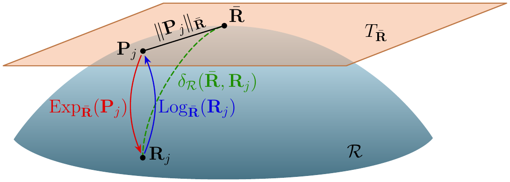

<div align="center">
<h1>Explicit Bounds for Tangent-Space Covariance Features in the Classification of Multivariate Time Series</h1>

[Daniil Dorin](https://github.com/DorinDaniil)<sup>1 :email:</sup>

<sup>1</sup> Moscow Institute of Physics and Technology, Moscow, Russia

<sup>:email:</sup> Corresponding author

[📝 Paper](#-citation), [</> Code](https://github.com/DorinDaniil/Tangent-Space-Features/tree/main/code)



</div>

## 💡 Abstract
Multivariate time series are classified by the covariance matrices of their channels. Each covariance is projected onto the tangent space of the manifold of positive definite matrices at the Riemannian mean of the sample, and the projection coordinates serve as features of a linear classifier. Three properties of these features are proved with explicit constants. The features are invariant to the units of measurement and to nonsingular mixing of the channels up to an orthogonal rotation that leaves a regularized logistic regression unchanged. Euclidean distances between the features never exceed the geodesic distances between the covariances and differ from them by at most a sharp factor determined by the spectral spread of the tangent vectors. The geodesic error of the sample covariance has a distribution independent of the true covariance and admits a nonasymptotic bound. Experiments on synthetic data and EEG recordings confirm that the bounds are conservative.

## 🛠️ Repository Structure
The repository is structured as follows:
- `code`: the code of the experiments.
  - `synthetic_experiments.py`: matrix tools, the four classifiers (TSM, MDM, log-Euclidean, Euclidean) and the three synthetic experiments (cloud radius, sharpness of the constant, covariance estimation noise); writes `results.json` and the figures of the paper to a `figs` folder created at the repository root.
  - `replot.py`: redraws the figures from `results.json` without rerunning the experiments.
  - `synthetic_experiments.ipynb`: the same experiments as a notebook.
  - `eeg_check/bci2a_check.py`: the check of the three theorems on the public EEG dataset BCI Competition IV 2a (left vs right hand motor imagery, 22 channels, 250 Hz); `bci2a_check_results.json` contains the results reported in the paper.

```shell
Tangent-Space-Features
├── LICENSE
├── README.md
├── requirements.txt
└── code
    ├── synthetic_experiments.py
    ├── replot.py
    ├── synthetic_experiments.ipynb
    ├── results.json
    └── eeg_check
        ├── bci2a_check.py
        └── bci2a_check_results.json
```

## 🚀 Running the Experiments
Install the dependencies and run the synthetic experiments:
```shell
pip install -r requirements.txt
python code/synthetic_experiments.py
```
The EEG check needs the training sessions `A01T.mat`, `A02T.mat`, `A03T.mat` of BCI Competition IV 2a (BNCI Horizon 2020 dataset 001-2014). Download them, for example from the mirror https://lampx.tugraz.at/~bci/database/001-2014/, into `code/eeg_check/bci2a` (or set the environment variable `BCI2A_DIR`) and run
```shell
python code/eeg_check/bci2a_check.py
```

## 📚 Citation
The paper is under review; the citation will be updated upon publication.
```BibTeX
@article{dorin2026tangent,
  title={Explicit bounds for tangent-space covariance features in the classification of multivariate time series},
  author={Dorin, Daniil},
  year={2026}
}
```
